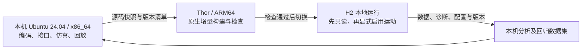

# 本机开发与 H2 部署验证流程 V1.0

日期：2026-11-02；实现状态更新：2026-11-03。本文是长期开发与部署设计；当前已实现本机 doctor/check、源码 bundle 和只读的 deploy 预览，其余远程操作未实现。实际命令见 [工具说明](../tools/README.md)，不能把本文的设计入口当作已验收脚本。

适用范围见 [首版功能范围](v1_scope.md)，模块关系见 [总体架构](software_architecture.md)。本方案细化现有开发、回放和部署能力，不新增 H2 步态控制研发或全功能物理仿真交付。

## 1. 推荐的长期工作方式

**本机负责日常编码、接口测试、导航仿真、真实数据回放和分析；Thor 负责 ARM64 构建、运行性能与真实机器人验证。**代码长期在本机维护，H2 端保留可重复构建的副本和版本化运行环境。



核心感知、定位、规划、监护和 SDK 适配都运行在 PC3；开发电脑不参与必需的实时控制闭环。SSH 用于部署与管理，不承担指令有效期或机器人失效停车机制。

当前本机为 Ubuntu 24.04 / x86_64，已安装 ROS 2 Jazzy、colcon、CMake、PCL 和 RTAB-Map，并验证基础工程。算法依赖使用独立工作空间，具体构建方式见 [依赖说明](../dependencies/README.md)。H2 端在首次接入时清点已有环境后再安装缺失项。

## 2. 本机验证分层

| 层级 | 实现方式 | 能验证什么 | 不能据此证明什么 |
| --- | --- | --- | --- |
| 接口与逻辑 | Mock H2 平台、可控状态/故障输入 | 消息契约、仲裁、限速、超时、任务/恢复状态机 | 真实 SDK/FSM 行为和机体响应 |
| 导航闭环 | 轻量运动学模拟，优先评估 Jazzy 的 nav2_loopback_sim | 目标和航点、路径跟踪、暂停/取消、合成障碍事件 | 真实定位精度、步行稳定性、制动距离 |
| 感知定位回归 | H2/MID-360 rosbag，重新运行 LIO、RTAB-Map 和重定位 | 实测数据的处理、退化、重定位与资源变化 | 新导航指令引起的新运动，或真实执行后的闭环效果 |
| 场景与合成传感器 | 按需使用 Gazebo Harmonic | 虚拟房间、动态障碍、覆盖与几何检查 | 未建模的 MID-360 扫描模式、噪声与 H2 步态 |
| 实机验证 | Thor + MID-360 + H2 | ARM64 依赖、真实接口、时间/外参、延迟和运动表现 | 未覆盖场景与未经测试的性能上限 |

Jazzy 官方的 Nav2 loopback 是由速度计算理想运动的轻量仿真，适合作为高层导航测试起点；Gazebo 官方将 ROS 2 Jazzy 与 Harmonic 配对。[Nav2 Jazzy 实现](https://github.com/ros-navigation/navigation2/tree/jazzy/nav2_loopback_sim)、[Gazebo 官方版本组合](https://gazebosim.org/docs/harmonic/ros_installation/)。

官方 Unitree MuJoCo 仓库已有 H2 模型，但 README 明确当前主要支持低层开发；有模型不代表已有可直接调用的 H2 高层 LocoClient 行走服务。因此，完整双足步态物理仿真不作为导航首版的开发前提。[Unitree MuJoCo](https://github.com/unitreerobotics/unitree_mujoco)。

轻量导航仿真可以直接使用理想里程计并替换定位链；若要验证 LIO，需要真实数据或物理/时间一致的合成三维点云与 IMU。合成感知与真实数据验证必须分别标记，不能用理想输入自证传感器算法准确。

## 3. 固定运行模式

| 模式 | 数据/平台来源 | 真实 H2 SDK 写入 | 主要用途 |
| --- | --- | --- | --- |
| `sim` | 运动学模拟和 Mock 状态 | 不启动 | 本机导航与任务闭环 |
| `replay` | rosbag 与对应标定/地图 | 不启动 | 本机估计重算或历史分析 |
| `hardware_readonly` | MID-360 和 H2 真实状态 | 不启动 | 上机接入、采集、定位及诊断 |
| `hardware` | 实机数据与已验收运动链 | 显式启用后才允许 | 受控实机建图/导航验证 |

运行模式与任务模式分开：实机的建图/导航互斥，`hardware` 本身也不能自动启动任务或发送非零速度。只读状态访问若使用 SDK，采用没有运动写入能力的进程/启动配置，不以“操作者暂时不发目标”替代隔离。

当前实现的 `hardware_readonly` 仅启动显式配置的 MID-360 原始采集，H2 状态由独立 SDK 被动探针记录，定位和 TF 封装仍待实现。首次目标机构建、实际配置、数据检查和录制命令见 [第一轮只读测试](first_hardware_test.md)。

仿真、回放与实机采用不同的 ROS DDS 域；Unitree SDK 自己的 domain 和网卡也单独配置。ROS_DOMAIN_ID 不能被假定同时约束独立 SDK 通道。仿真/回放不加载真实运动写入进程，即使连接机器人网络也没有实机控制路径。

## 4. 最简部署选择

首版采用 **SSH + rsync + Thor 原生 colcon 构建 + systemd 管理**。机器人首次完成网络、SSH、依赖和目录配置后，日常部署由本机工具封装为一个入口。

- 本机与 Thor 使用相同 ROS 发行版、源码依赖清单、消息定义及参数结构，按各自 CPU 架构分别构建。
- 只传源码、启动文件、随版本维护的默认配置和清单。不传本机的 `build/`、`install/`、`log/`、Python 环境或系统动态库。
- 锁定第三方仓库提交，保存实际 ROS/SDK/BSP/JetPack 版本。首次装依赖后，常规部署不自动升级系统或跟随依赖 `main`。
- Thor 原生增量构建作为第一选择；交叉编译、容器、多架构构建服务在出现实际维护收益后再加入，不作为首次部署前提。
- 不通过远程覆盖正在运行的源码和安装目录来发布。构建/切换在任务停止、机器人处于适合维护的状态下执行；避免编译竞争影响运行中的感知与监护。

## 5. 目标机目录与回滚

建议使用专用用户目录，以下路径仅为设计示例：

```text
~/h2_nav/
  slots/
    A/                     固定路径，含源码、build、install、log、版本清单
    B/                     另一固定路径
  current -> slots/A       当前选定版本
  config/                 分版本的实机网卡、标定、运动限制和模式配置
  maps/                   分版本的地图包和地点索引
  data/                   rosbag 与采集清单
  runs/                   运行日志、报告和每次运行的版本记录
```

同步和构建仅操作未激活槽位；成功后停止旧服务、切换 `current` 并以只读模式启动新版本。保留旧槽位供回滚。回滚同样回到禁止运动状态，不恢复旧任务。

每个槽位的构建与运行路径保持固定，不在构建后任意移动 colcon 的安装目录。正式槽位采用复制式安装；不让运行时依赖本机或可变源码的符号链接。检测到删除包、ABI 或依赖变化时，清理未激活槽位受影响的构建/安装缓存，再重新构建，防止残留包被继续发现。

目标构建在干净环境中只加载固定的系统 ROS/版本化第三方依赖 underlay，不加载 `current` 或另一槽位的 ROS overlay；运行时也只加载所选槽位及其对应依赖，防止 A/B 互相产生隐式路径依赖。

实机配置、标定、地图与数据放在槽位外，但按版本管理；每次运行绑定确定的配置/地图版本。代码回滚前检查其兼容性，不能只回退程序却静默沿用不兼容地图或数据库结构。

A/B 仅直接回退项目代码及构建产物，不能自动回退共享的 ROS、SDK、系统库、BSP 或机器人固件。共享依赖发生变化后，旧槽位只有通过当前依赖兼容检查才可回滚；不兼容时拒绝自动回滚。需要并存的第三方库采用独立版本前缀，而非覆盖旧运行依赖。

rsync 的删除操作如需启用，只能指向经校验的专用未激活源码目录；不能覆盖 `config/`、`maps/`、`data/` 或运行日志。A/B 两个源码目录是互相独立的快照，不能使用会连带修改活动源码的硬链接共享。

## 6. 一次日常更新的步骤

1. 本机形成明确的源码快照和依赖清单，通过本次变更相关的接口/仿真/回放检查；记录快照标识与配置版本。
2. 本机通过 SSH 检查目标架构、ROS/SDK、磁盘、现有服务状态及配置完整性；版本不兼容或机器人仍在任务中时不切换。
3. rsync 到未激活槽位，校验同步结果，Thor 原生增量构建；失败时保留当前可用版本并返回日志。
4. 检查构建产物、包可发现性及启动配置，形成带版本的候选部署记录。
5. 停止旧项目服务，确认运动许可已撤销且机器人适合切换，再原子切换 `current` 并启动只读服务；没有可靠停机确认则停止发布。
6. 检查雷达、IMU、机器人状态、时间链、TF、定位、诊断和资源占用。只读检查失败时停止候选服务并回退旧槽位的只读服务，保存失败证据。
7. 操作者按场地要求显式启用实机运动并提交新任务；任务与数据记录绑定本次版本。部署工具本身不发送导航目标。
8. 将本次 bag、诊断、配置快照和结果拉回本机，纳入回放与回归数据集。

未激活槽位的构建缓存不作为“此版本已构建成功”的证据；每次发布依据源码标识、构建返回值和检查报告判定。服务重启、断电恢复及回滚均不自动获取运动许可。

## 7. 拟实现的便捷工具入口

以下区分已有工具与后续接口约定；尚未实现的入口不能当作命令执行：

| 入口 | 预期操作 |
| --- | --- |
| `doctor` | 已实现本机工具/ROS 环境检查；目标网络及配置检查待实现 |
| `check` | 已实现 core 和 ROS 基础包构建、测试及本轮结果检查；算法回放回归待集成 |
| `bundle` | 已实现源码快照及哈希清单；不是 ARM64 二进制包 |
| `deploy --preview` | 已实现只读方案预览；同步、构建、切换和只读启动的远程执行尚未实现 |
| `status` | 待实现：查看目标版本、模式、服务、传感器与定位健康状态 |
| `stop` | 待实现：通过停车/许可撤销流程停止任务和服务，并报告确认结果 |
| `collect` | 待实现：拉取指定运行的数据和报告，不删除目标原始数据 |
| `rollback` | 待实现：检查兼容性后切回上个槽位，只读启动并保存回滚记录 |

运动启用是独立的显式操作，不合并到 `deploy`、`rollback` 或 `status`。目标地址、用户名、网卡和路径在首次接入后保存到本机目标配置；部署无需每次人工重复输入长命令。

## 8. 采集、回放与分析约定

H2 每次采集至少保留：原始点云及逐点时间、雷达 IMU、必要机身/关节/遥控状态、TF/标定、估计与任务状态、监护事件、原始指令及有效期诊断；同时保存源码、依赖、参数、地图和标定版本。采用显式话题清单、QoS 检查和磁盘限额，避免高带宽记录阻塞控制链。ROS 官方工具支持记录与重放供实验复现。[ROS 2 Jazzy 数据记录与回放文档源码](https://github.com/ros2/ros2_documentation/blob/jazzy/source/Tutorials/Beginner-CLI-Tools/Recording-And-Playing-Back-Data/Recording-And-Playing-Back-Data.rst)。

两种回放用途互斥：

- **重算算法**：回放原始传感器及必要状态，重新生成估计与 TF；过滤历史算法产生的同名里程计/TF，确保每条变换和数据只有一个发布者。
- **查看历史**：回放当时的估计、任务和 TF 结果，关闭会重复发布这些结果的算法节点。

回放采用 `/clock` 与 `use_sim_time`；倍速、暂停和倒放/跳转的测试需明确处理状态，时间回退时重置估计器。实机命令 watchdog 始终使用单调时钟；可控时间的离线逻辑测试通过测试时钟接口完成，不将回放时钟带入实机保护。

回放只重现已有轨迹，不会因本次算法生成新速度而改变后续记录数据；真正导航闭环使用运动学/场景模拟或 H2 实机。数据回归主要对比轨迹、定位质量、重定位正确/拒绝、延迟、丢帧、CPU/内存以及故障响应。

## 9. 首次接入与日常迭代的区别

首次接入需要：确认目标地址和 SSH、清点 Thor BSP/SDK、安装缺失依赖、标定安装与时间链、建立配置和地图目录、验证机器人端停止/接管、完成初始采集。

完成后，日常流程固定为：**本机修改和检查 → 一次部署 → H2 只读检查 → 显式实机试验 → 拉回数据 → 本机回归**。环境安装与硬件校准无需每次重做；硬件、固件、标定或依赖发生变化时重新执行相应检查。
