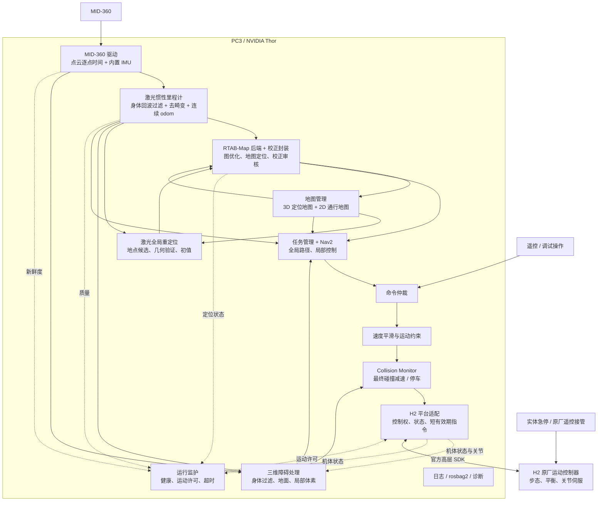

# H2 自主定位导航软件架构 V0.4

日期：2026-11-02。状态：首版总体架构；功能范围已按 [首版范围基线 V1.0](v1_scope.md) 固定，详细接口/依赖版本待实现阶段收敛；尚未完成实机接口、性能与运动验证。

## 1. 目标与设计结论

已确认硬件为宇树 H2、Livox MID-360、PC3 NVIDIA Thor；PC3 系统为 Ubuntu 24.04。第一阶段场景为室内平层的走廊、房间和门口；雷达刚性固定于 PC3 背包或躯干。

推荐路线：**ROS 2 Jazzy + FAST-LIO2 前端 + RTAB-Map 建图/定位后端 + 三维障碍处理 + Nav2 平面导航 + H2 高层运动适配 + 独立运行监护**。RTAB-Map 为首版后端首选候选，接口独立封装；通过 MID-360/H2 数据回放和 Thor 实测后冻结具体版本。

PC3 负责感知、建图、定位、规划与任务；H2 原厂控制器负责步态、平衡和关节控制。两者通过高层速度与运动状态接口连接。首版只执行经验证的平层通行，不包括上下楼梯、跨越台阶、开门、乘电梯、自动起身及足步规划。

首版功能：人工遥控建图、地图保存与加载、已建地图内的自动初定位、定位丢失后停车及自动重定位、人工初值兜底、单点/多点导航、动态障碍停车与绕行、任务取消、遥控接管和运行记录。自动重定位限定在已验证覆盖区域、稳定站立及雷达/IMU 正常的条件下，允许因歧义或观测不足返回失败。关着的门视为障碍；门口是否可通行由实际净宽、身体包络和定位误差共同决定。

首版功能、失败反馈和恢复语义以 [范围基线](v1_scope.md) 为准。建图与自主导航互斥；仅全局定位失锁且局部估计/控制持续有效时，允许通过重定位验证和重规划后条件续行。人工暂停、接管、急停、故障或重启的恢复遵循范围基线，不因再次定位成功而自行恢复旧任务。

## 2. 系统结构



图中为逻辑模块，不表示每个方框都必须单独部署。观测与日志订阅各模块，图中省略其连线。

## 3. 技术基线与兼容性

| 项目 | 建议 | 冻结版本前的条件 |
| --- | --- | --- |
| PC3 系统 | 已确认 Ubuntu 24.04；采用 ROS 2 Jazzy / ARM64，保留宇树交付的 Thor BSP/JetPack | 核对 JetPack、内核、SDK ABI；不直接重刷通用开发套件镜像 |
| 运行语言 | 高频路径 C++；启动、工具及离线分析使用 Python | 不让 Python 工具阻塞指令或传感器处理 |
| 雷达接入 | Livox-SDK2 + livox_ros_driver2 | 锁定提交、时间字段格式、掉线重连与数据完整性 |
| LIO | FAST-LIO2 算法优先，维护项目选定的 ROS 2 适配版本 | 使用本机 MID-360 数据回放及 Thor 实测后选定实现 |
| 建图后端 | 首选 RTAB-Map：关键帧、空间邻近闭环、图优化、数据库与地图装配 | 回环质量、图更新资源、数据库持久化及导出地图一致性验证 |
| 地图定位 | RTAB-Map 定位模式 + 独立激光重定位 + 定位质量封装；保留人工初值 | 已覆盖区域的无先验启动、长走廊/重复房间歧义及失锁恢复验证 |
| 导航 | 首版 Nav2 + NavFn + Regulated Pure Pursuit；MPPI 作为后续优化候选 | 路径平滑及曲率检查；首版禁用侧移、倒退和自动旋转恢复 |
| 运动接入 | 官方 H2 LocoClient，封装进平台适配层 | 实测 FSM、速度坐标系、限幅、停车与接管行为 |
| 运维 | ROS 2 lifecycle + systemd；版本固定的构建/运行环境 | 明确启动依赖、失败停车、重启后禁止自动恢复运动 |

依据：NVIDIA 当前 JetPack 7 使用 Ubuntu 24.04，ROS 2 Jazzy 提供 Noble arm64 支持；但宇树 ROS 2 仓库只明确列出 Foxy/Humble 的测试环境，因此 Jazzy 与 H2 的整机组合仍需验证。若 SDK 所需 CycloneDDS/ABI 与 ROS 2 运行时冲突，将 SDK 通信放入独立进程，通过 Unix socket 等本地 IPC 与 ROS 2 适配节点交换命令及状态。该隔离是工程备选方案，不是已验证的官方组合。[NVIDIA JetPack](https://developer.nvidia.com/embedded/jetpack)、[ROS 2 Jazzy 安装文档源码](https://github.com/ros2/ros2_documentation/blob/jazzy/source/Installation/Ubuntu-Install-Debs.rst)、[Unitree ROS 2](https://github.com/unitreerobotics/unitree_ros2)。

Livox 官方驱动已提供 Jazzy 构建路径，但将自身定位为调试工具，产品化需完善异常恢复和资源管理。FAST-LIO 官方已有 MID-360 配置，官方主仓启动链仍为 ROS 1；ROS 2 移植、消息适配及维护成本必须计入研发计划。[Livox 驱动](https://github.com/Livox-SDK/livox_ros_driver2)、[FAST-LIO](https://github.com/hku-mars/FAST_LIO)。

Thor GPU 首版不作为 LIO/Nav2 的必需条件；CPU 先保证导航链路。标准 MPPI 不能视为自动使用 CUDA。后续语义感知、深度处理等 GPU 任务应有独立资源预算。

## 4. 模块职责与接口

以下话题名是项目约定，封装第三方节点时通过 remap 统一，不代表厂商原生话题。

| 模块 / 建议包 | 主要输入 | 主要输出与职责 |
| --- | --- | --- |
| `h2_description` | 标定参数、URDF、关节状态 | 机器人几何、碰撞模型、雷达到机体的外参链 |
| `h2_sensor_io` | MID-360 UDP | `/sensors/lidar/raw`、`/sensors/imu/lidar`、链路及时间诊断 |
| `h2_platform_adapter` | 安全处理后的速度、运动许可；SDK 状态 | `/robot/state`、`/joint_states`、IMU、可用时的厂商里程计；唯一 SDK 运动写入点 |
| `h2_lio` | 带逐点时间的点云、内置 IMU、身体过滤模型/同步关节 | `/state/odom_3d`、去畸变点云、LIO 质量；局部连续坐标 |
| `h2_state_frames` | LIO 位姿、同步关节、外参 | `/state/odom_body_3d` 完整机体里程计、`/state/odom` 平面导航里程计、局部 TF；雷达/躯干位姿转换到导航基准 |
| `h2_mapping` | 去畸变局部点云、完整机体里程计 | RTAB-Map 建图模式封装：闭环、位姿图、数据库和优化后的地图；只在建图模式运行 |
| `h2_localization` | RTAB-Map 定位结果、冻结地图、LIO、初始位姿 | `/localization/status`；定位跟踪、初值管理与失锁处理 |
| `h2_relocalization` | 冻结关键帧/子图索引、过滤且重力对齐的查询云、质量状态 | 多地点候选、粗到细配准及可信度检查；通过审核的机体初始位姿或明确失败 |
| `h2_global_frames` | 建图或定位模式的 RTAB-Map 校正、质量与同步局部位姿 | 两种模式共享的校正封装；唯一发布审核后的 `map→odom` |
| `h2_map_manager` | RTAB-Map 数据库/导出地图、人工编辑 | 地图版本、三维定位地图、二维栅格、禁行/限速区域、航点 |
| `h2_perception` | 点云、局部姿态、关节和机器人模型 | 去除身体回波、地面分类、局部体素/高度、障碍云、观测有效范围 |
| `h2_navigation` | 目标、地图、里程计、障碍与定位状态 | Nav2 action、路径与 `/motion/nav_cmd`；到达/失败/取消状态 |
| `h2_motion_guard` | 自动/人工指令、障碍、健康状态 | 仲裁、平滑、碰撞限制；`/motion/safe_cmd` |
| `h2_supervisor` | 各模块诊断、H2 状态 | 状态机、运动许可租约、故障原因、生命周期协调 |
| `h2_bringup` / `h2_tools` | 模式配置、版本清单 | 建图/定位/导航启动入口、RViz、数据记录与回放 |

点云队列采用小深度并优先处理最新有效帧，记录丢帧和积压；IMU 则保留覆盖去畸变窗口的有序样本，不能为了追新直接丢弃中间积分数据，缺样时标记估计质量并处理失效。QoS 必须与驱动实测匹配。地图及关键任务状态采用可靠传输。所有运动消息包含时间、来源、序号及有效期；Nav2 版本若输出无时间戳 Twist，在进入项目运动链路时由适配器补齐，并独立检查上游活性。平滑和重发不能刷新原始命令的有效期，避免旧指令被持续续命。

## 5. 定位、地图及坐标系

### 5.1 局部连续与全局校正分离

LIO 以 MID-360 内置 IMU 为首版主惯性源，保留完整 6DoF 姿态及逐点去畸变。雷达 IMU 与机身 IMU 先做一致性检查；未经外参、时钟和相关性建模，不直接将多个 IMU 或已有融合里程计再次投入同一滤波器。

身体回波必须在 LIO 配准之前剔除，而非只在导航障碍分支过滤；两个分支共享依据 URDF/同步关节生成的过滤逻辑。LIO 前在雷达坐标下按逐点或足够短分段时刻的关节几何生成自体掩膜，并保留剩余点的原始时间。LIO 初始化执行经验证的静止/低运动条件检查；IMU 偏置和重力初始化未完成时不允许自主行走。

- 建图模式：人工遥控 → LIO → 关键帧 → 回环几何验证 → 位姿图优化 → 重新生成地图。完成后检查门口、走廊和静态障碍，生成可发布的版本。
- 定位模式：RTAB-Map 加载冻结数据库；存在可靠初始位姿时直接跟踪，缺少初值或失锁时，在稳定站立条件下调用激光地点检索与几何验证，审核后将初值交给 RTAB-Map 再次验证。歧义、低重叠或观测不足时保持停车，使用人工初值兜底。
- 定位质量同时考虑匹配残差、有效匹配比例、几何退化、时间新鲜度与运动一致性。不能只凭 ICP 返回成功或一个分数宣布定位有效。
- 失锁先停止导航，再执行重定位；恢复后先验证稳定性、重规划，再由明确的恢复策略重新获得运动许可。
- 全局优化与重定位只修正 `map→odom`。LIO 的 `odom` 连续，不被回环直接重置。LIO 自身重启时必须进入失效处理，不能伪装成连续运行。

### 5.2 TF 的唯一发布者

```text
map
 └─ odom                         后端校正封装发布 map→odom
     └─ base_footprint            状态适配层发布平面位置、航向
         └─ base_link            状态适配层发布高度、roll/pitch 等
             └─ torso_link       有腰部运动时由同步关节状态生成
                 └─ lidar_link   雷达安装在躯干/背包时的刚性外参
                     └─ lidar_imu_link
```

`base_link` 建议定义在骨盆参考刚体；`base_footprint` 为其在平层参考地面上的投影，供 Nav2 使用。实际 URDF 连杆名称和雷达支撑刚体以安装结构为准。状态适配层将完整机体位姿分解为上述两段，保证它们的乘积等于原始 6DoF 机体位姿，避免重复发布 `odom→base_link`。

LIO 原生 world 必须显式完成重力对齐并确定平层地面参考后，才作为本项目的 `odom`；不能假定任一 ROS 2 移植都已完成这一步。`map` 同样保持重力对齐，与导航栅格使用一致的地面参考。三维地图配准的 roll/pitch 校正需做一致性及界限检查，不能任意倾斜 Nav2 的导航平面。

雷达相对机体基准若存在腰关节运动，则 `T_base_lidar(t)` 为动态变换：由 LIO 得到 `T_odom_lidar(t)` 后，利用同一时刻的关节变换求机体位姿。雷达刚性安装并不代表雷达到骨盆的整条链恒定。关节数据缺失或时间不可靠时，需通过经过验证的固定腰部工作姿态或调整安装结构解决，不能直接写死动态链。

### 5.3 地图分为三类

1. **全局定位地图**：静态三维点云/子图、关键帧、定位检索索引；用于长期定位。
2. **导航地图**：从三维几何生成的二维占据与通行代价、禁行区、限速区、航点。未知区域不直接解释为空地。
3. **局部障碍地图**：滚动三维体素/高度信息及其二维代价投影；融合实时障碍并进行有观测依据的清除，不把行人写入静态定位地图。

地图包应保存 `map_id/version`、坐标原点、栅格分辨率、边界、标定版本和适用机器人轮廓；三维定位图与二维导航图必须共享同一优化坐标。首版可从 0.05 m 栅格开始调试，最终分辨率由门口净宽、测量误差和算力决定。

### 5.4 RTAB-Map 后端决策及接入边界

**需要闭环、图优化和持久地图后端能力；RTAB-Map 本身可以替换。首版优先采用它，以减少自研数据库、图优化和地图装配工作量。**官方 ROS 2 包支持 Jazzy/Ubuntu 24.04，且允许使用外部里程计。[RTAB-Map ROS 2 官方仓库](https://github.com/introlab/rtabmap_ros)。

FAST-LIO2 继续负责 IMU 积分、点云去畸变和连续局部里程计；RTAB-Map 使用该里程计建立相邻关键帧约束，再利用匹配约束优化图并生成地图。项目只启动一个主里程计前端，不再同时启动 RTAB-Map 的 `icp_odometry`，也不对已去畸变的三维点云重复去畸变。官方 `lidar3d.launch.py` 可作参考，但其中包含自己的 ICP 里程计和可选去畸变节点，不能整套照搬。[官方三维激光示例](https://github.com/introlab/rtabmap_ros/blob/ros2/rtabmap_examples/launch/lidar3d.launch.py)。

纯激光时没有视觉词袋，常规闭环主要依赖当前估计附近的空间邻近候选。ICP 用于几何配准，并不自动产生任意未知地点的全局检索能力，因此首版增加独立激光重定位模块提供经过验证的初值。持续存在 `map→odom` TF 不代表当前已经匹配成功，运动许可必须检查有效匹配与新鲜度。[官方节点文档：纯激光与定位](https://github.com/introlab/rtabmap_ros/blob/ros2/rtabmap_slam/doc/rtabmap.md)。

接入契约如下：

- **里程计**：输入 `/state/odom_body_3d`，`header.frame_id=odom`、`child_frame_id=base_link`；保留真实高度与 roll/pitch，不能使用 Nav2 的平面投影里程计。相邻图约束需要适当的不确定性权重；适配层核对选定版本的 covariance 解释，不直接照搬 LIO 的累计状态协方差，也不填全零制造虚假确定性。
- **点云**：输入自体过滤、已去畸变的每帧 `PointCloud2`，统一到明确的扫描参考时刻，并在同一时刻的 `lidar_link` 或 `base_link` 下表达。若 LIO 输出世界坐标点云，先真正变换回局部参考坐标；不能仅修改 frame 名称，也不能将累计全局点云当成每帧扫描。
- **TF**：连续局部 TF 仍由状态适配层维护；RTAB-Map 设置 `publish_tf=false`，共享的后端校正封装 `h2_global_frames` 在建图和定位两种模式均运行，读取相应模式的校正/同步位姿与质量后，唯一发布审核通过的 `map→odom`。异常校正撤销运动许可；建图中还需检查错误闭环对图本身的影响，单靠拦截 TF 不能修复错误地图。
- **运行模式**：建图使用 `Mem/IncrementalMemory=true`，保存并审核数据库与地图包后，导航使用 `false` 的定位模式。两种模式复用同一 RTAB-Map 后端实现，互斥启动，不并行运行两套主图优化。地图包包含 `rtabmap.db`、导出地图及项目元数据；正式地图禁止使用示例中的 `-d` 启动参数。数据库持久化和非正常退出恢复要单独验证。
- **速率**：图更新从 1～2 Hz 起步，关键帧还按距离/转角筛选；高频运动状态由 LIO 提供。根据工作内存、处理时间、误匹配率与定位新鲜度决定调参，不按每帧雷达数据无限扩张图。

上述 covariance、频率与建图/定位模式约定参见 [RTAB-Map 官方运行约定](https://github.com/introlab/rtabmap_ros/blob/ros2/rtabmap_slam/README.md)。

配置方向为：`subscribe_scan_cloud=true`，关闭 RGB/depth/RGB-D 订阅，`Reg/Strategy=1` 使用 ICP；不订阅外部 LIO 未提供的 RTAB `OdomInfo`。配准和图优化保留 6DoF，并结合已重力对齐的 LIO 评估重力约束，避免直接把人形机体运动压成平面。具体参数、类型和可用优化器以冻结版本为准。

RTAB-Map 导出的栅格作为导航地图生成输入，仍需按 H2 的全身包络、地面覆盖和禁行规则审核。实时动态障碍及停车链继续独立于建图后端；首版路径规划和速度控制统一由 Nav2 执行。

### 5.5 首版激光地点检索与几何验证

该模块纳入首版 P2 的交付范围，开发顺序在 LIO 和可用地图之后。首版支持已覆盖、已验证地图区域内的启动初定位与失锁停车后的恢复，不承诺所有位置、任意姿态和任意遮挡下必然成功；具体成功、拒绝与任务续行条件见范围基线。

建议流程：

```text
冻结地图关键帧及局部子图索引
  + 自体过滤、去畸变并重力对齐的查询点云
  → Scan Context 多候选地点及粗航向
  → 候选子图的粗到细几何配准
  → 重叠率、残差分布、退化与多候选歧义检查
  → 跨帧稳定性检查
  → 向 RTAB-Map 提交一次初始机体位姿
  → 后端跟踪重新验证
  → 校正封装和运行监护决定是否恢复导航
```

候选检索先采用 Scan Context 作为可复现基线；细配准评估 GICP，例如 small_gicp。Scan Context 提供地点/关键帧候选和粗航向，不提供完整可靠的六自由度位姿；GICP 是局部精配准。候选位置偏差超过其收敛范围时，需要更密的地图关键帧、受限的多平移/航向初值或额外粗配准，不能直接认定已有全局求解保证。[Scan Context 作者实现](https://github.com/gisbi-kim/scancontext_tro)、[small_gicp 作者实现](https://github.com/koide3/small_gicp)。

工程契约：

- 建库与查询保持相同的雷达中心、重力/高度约定、有效距离和点云预处理。描述子索引、关键帧优化位姿、局部子图与地图版本一致，地图优化/更新后同步重建或更新关联。
- 针对室内 MID-360 数据重新确定描述子半径、分辨率和阈值；采用冻结数据库 Top-K 查询接口，不照搬在线回环示例中排除最近若干帧的逻辑。Scan Context++ 等改进描述子可作为对比候选，不能仅因名称升级而默认更适合室内。
- 人形行走有姿态、高度和遮挡变化；重定位先停车并等待稳定观测。允许短时累积，但只用质量可靠的局部运动补偿；LIO 已发散或重启未初始化时禁止用错误位姿拼接查询云。作者的 Scan Context++ 研究也对较大 roll/pitch 变化设有限制。[作者论文](https://arxiv.org/abs/2109.13494)。
- 描述子分数和低配准残差均不能单独放行。多帧一致只能检查稳定性，不能消除完全重复结构的地点歧义；存在多个相近候选时拒绝自动定位并保留人工初值。首版不通过盲目行走或自转寻找特征。
- 模块不维护第二套位姿图、不发布 `map→odom`。首版在定位模式下经坐标/时间换算，将通过审核的 `T_map_base` 作为 RTAB-Map 的 `initialpose`，随后检查后端的有效匹配。建图时把检索结果转成远距离闭环约束注入主图，可作为后续独立扩展。
- 验收分别统计候选召回、正确定位、错误接受、拒绝率和 P95 耗时；覆盖反向启动、重复房间、长走廊、人员遮挡、地图外位置及失锁恢复。使用独立真值或人工核验，不能用配准残差自证地点正确；未观测到误接受不代表已证明零误接受。

### 5.6 IMU 使用方案

IMU 是首版定位链路的必需输入。主惯性源为 MID-360 内置 IMU；H2 机身 IMU 首版用于状态监测和经过坐标/时间对齐的一致性检查，不直接将两路原始 IMU 同时投入 LIO。

| 环节 | IMU 的作用 |
| --- | --- |
| FAST-LIO2 | 使用角速度、加速度进行状态预测，与点云匹配共同估计运动、姿态及偏置，并完成逐点去畸变 |
| 坐标与障碍处理 | 使用可靠的重力方向建立水平参考，保留机体实际 roll/pitch/高度，再生成 Nav2 平面投影 |
| 激光重定位 | 建库和查询按同一重力约定对齐；IMU 未初始化或质量不可靠时，不放行依赖该姿态的自动重定位 |
| RTAB-Map | 主要接收已经融合 IMU 的 LIO 里程计；若配置后端重力约束，使用经过验证的姿态来源，不把原始加速度/角速度当作姿态四元数 |
| H2 状态监测 | 结合原厂状态和机身 IMU 检查姿态异常；阈值按正常步行摆动和运动模式验证 |

IMU 负责短时运动信息与重力参考，不能单独消除长期位置或航向漂移；长期校正仍依靠激光地图匹配、闭环及重定位。IMU 数据超时、缺样或初始化失败时，降低估计质量并撤销相应自主运动许可，不静默切换成未经验证的纯激光模式。

## 6. 人形机器人特有的感知与导航约束

### 6.1 障碍处理

以重力和局部地面为参考分析三维点云，再投影导航代价，不能只取某个固定世界 z 高度切片。过滤身体时使用机器人几何及动态关节，避免将摆臂、摆腿当成环境，也避免用过大的固定裁剪盒抹掉脚边障碍。

碰撞空间覆盖足部摆动、身体、肩部、头部、手臂和背包。首版采用受限手臂/腰部姿态下的保守水平包络，加定位误差及跟踪误差余量；通道不满足实际包络时拒绝通过。后续再根据姿态扩展分高度碰撞检查。

MID-360 的垂直视场为 −7°～52°，高位水平安装对近脚地面的覆盖不足。安装评审要画出地面可见范围和身体遮挡，必要时评估俯仰安装的收益与代价。仅依靠该单雷达不能保证坑洞、楼梯口、透明物和所有低矮障碍的可靠识别：首版通过已验证平地范围和禁行区域限制任务；扩展此类场景时增加向下深度/其他合适传感器。[MID-360 官方参数](https://www.livoxtech.com/cn/mid-360/specs)。

### 6.2 规划与控制

全局规划采用 NavFn，并配合路径平滑、障碍净距及转弯可执行性检查。首版使用 Regulated Pure Pursuit，执行已验证的前进与转向；侧移、倒退以及恢复行为中的原地自转不纳入首版。后续扩展全向绕障时可评估 MPPI Omni，并用实测速度、加速度、响应延迟和停止距离调参。[Nav2 调参指南](https://docs.nav2.org/rolling/configuration_and_development/tuning_guide/)、[MPPI 官方实现说明](https://github.com/ros-navigation/navigation2/blob/main/nav2_mppi_controller/README.md)。

NavFn 首版按覆盖全身投影的保守外接圆规划，并对平滑后路径执行实际包络碰撞复核；不能假定它完成了非圆形身体的朝向碰撞搜索。这会拒绝部分实际可过的窄门。需要提高狭窄通行能力时，再加入基于姿态的全路径碰撞检查及相应规划器。正常路径对齐和终点调向也须通过原地转向验收；未通过时限制任务的初始/目标朝向，不能依赖恢复动作兜底。

全局 costmap 组合静态地图、禁行/限速信息、有效的实时障碍和膨胀层；局部 costmap 组合滚动三维障碍投影与膨胀层。行人突然进入路径时先减速/停车，再根据持续观测触发等待或全局重规划；没有可验证的绕行空间时维持停车。首版不承诺人群轨迹预测或高速穿行。

Nav2 输出的是机体期望速度，不是足端轨迹。运动约束包括纵/横向限速、转向限速、加减速度、加加速度和起停响应；不使用底盘轮距等轮式参数代替 H2 的实测运动能力。最终到达判断同时检查位置、朝向和实际速度，不能因步行摆动反复切换到达状态。

## 7. 运动链路与运行监护

严格的命令路径：

```text
导航 / 人工指令
  → 来源仲裁
  → 速度平滑与运动约束
  → Collision Monitor
  → H2 平台适配层（许可、有效期、最终限制）
  → H2 原厂高层控制器
```

所有 PC3 上的运动来源都经过同一条处理路径。Collision Monitor 后不再进行会延迟停车或增加速度的平滑/规划。平台适配层只做运动许可检查、超时停车和更严格的限制，不能在末端产生绕过感知限制的非零运动。Collision Monitor 使用新鲜传感器观测，不依赖全局定位成功才可停车；传感器失效则拒绝继续运动。该软件层不提供硬实时安全认证，实体急停及原厂保护仍直接作用于机器人。[Nav2 Collision Monitor](https://docs.nav2.org/rolling/tutorials/general_tutorials/using_collision_monitor/using_collision_monitor/)。

官方 H2 `LocoClient` 提供 `SetVelocity(vx, vy, omega, duration)`、`GetFsmId/GetFsmMode/GetAvailableFsmIds` 和 `StopMove()`。适配层查询并验证实机状态，首版不自动执行未经确认的模式切换。`Move(..., continuous=true)` 在当前源码中使用很长的 duration；项目应改用短有效期、周期续期的接口，并实测固件是否在到期后停止。`StopMove()` 是零速命令，不能当作实体急停或稳站模式切换。[H2 LocoClient 源码](https://github.com/unitreerobotics/unitree_sdk2/blob/main/include/unitree/robot/h2/loco/h2_loco_client.hpp)。

必须覆盖以下失效范围：

- 上游任务/规划器退出：指令新鲜度和来源心跳到期，适配层停止续期并停车。
- 运行监护退出：运动许可租约到期，适配层禁止继续发送非零速度。
- 适配层或 PC3 整体失效、通信断开：由实测有效的机器人端指令到期/看门狗执行停止；仅靠 PC3 发零速不能覆盖自身掉电。
- 原厂遥控接管：抢占自主控制，取消当前任务并清除剩余航点；不能继续周期发送与人工竞争的速度，重新获得控制权后需提交新任务。
- 实体急停：撤销自主运动许可，任务停止执行；急停解除并完成就绪检查后仍需显式操作才能重新运行任务，不能恢复旧速度。

若不能证明机器人端在 PC3 失效时能够可靠停止，则接入阶段验收未通过，不能进入自主行走试验。

建议状态机：`BOOT → SELF_CHECK → STANDBY → LOCALIZING → READY → NAVIGATING`；分支为 `MAPPING`、`MANUAL`、`PAUSED`、`FAULT`、`ESTOP`。自主导航获得运动许可需同时满足传感器、时钟、TF、全局定位、H2 可运动状态和控制权条件；PC3 人工建图模式要求传感器、局部 LIO/TF 和安全链有效，但不要求已有全局地图。原厂遥控器直接接管作为独立人工模式处理。定位失锁/雷达超时/TF 断链/状态异常触发相应模式停车并撤销许可。零速、稳站、阻尼和硬件急停分别建模，禁止将一般避障停车直接映射成可能失去支撑的关节状态。

安全距离使用实测参数确定：`d_stop ≥ v × 总反应时间 + 实测制动距离 + 包络/误差余量`。总反应时间包含传感器周期、计算、DDS/SDK 和原厂控制器响应；首版不以轮式匀减速假设替代步行停车测量。

## 8. 时间、网络、进程与性能

### 时间和网络

- 雷达采用有线接入 PC3；机器人 SDK 通信绑定明确网卡。雷达网、机器人控制网及调试/上传流量分离，物理口不足时再评估交换机/VLAN，避免误路由与 DDS 发现扩散。
- MID-360 支持 PTPv2，但需核对 PC3 网口硬件时间戳和交换机能力，选择实际可实现的同步方式；不能把电脑时间同步等同雷达已同步。
- 建立雷达时钟、PC3 时间、H2 状态 tick/时间戳的映射及误差监测；跨传感器对齐使用采集时间，不用消息到达时刻替代。
- 保留逐点时间、IMU 时间和驱动原始元数据；避免在 LIO 前将点云变成仅含 XYZ 的消息。消息时间用于对齐；独立单调时钟用于 watchdog，避免系统校时影响超时逻辑。

### 运行部署

感知/LIO、导航、运动适配与运行监护分进程，防止一个模块异常拖垮整条链；只在实测有收益时对大点云采用 composition/进程内传输。若 SDK 运行时隔离，其 IPC 同样携带序号、时戳与有效期，断连即失效。

首版用 systemd 管理进程组，ROS lifecycle 管理就绪依赖；不引入集群编排。调试时 RViz 与离线分析优先在外部工作站运行。记录数据采用限额轮转及事件保留，磁盘满或上传拥塞不能阻塞控制链。

长期采用本机 x86_64 编码、接口/导航仿真、回放与分析，Thor ARM64 原生构建及实机验证；通过 SSH/rsync、固定 A/B 槽位与只读启动简化日常发布。两端构建产物分离，实机配置/地图/数据独立版本管理。详细步骤、仿真能力边界与待实现工具入口见 [本机开发与部署流程](development_deployment.md)。

### 初始调试预算

以下是工程起点，不是已验证指标；以实机 SDK 支持和端到端测量为准。

| 链路 | 初始目标 |
| --- | --- |
| 点云处理 / LIO 校正 | 10 Hz；IMU 预测按实际 IMU 数据率运行 |
| 导航里程计 / 局部 TF | 50～100 Hz；需要有效 IMU 预测，不是重复旧位姿 |
| RTAB-Map 图更新 / 地图定位 | 1～2 Hz 起步；定位模式按实测新鲜度调整，大地图限制工作集 |
| 全局路径更新 | 事件触发，必要时约 1 Hz 重规划 |
| 局部控制 | 20 Hz |
| 运动平滑、SDK 发送与 watchdog 检查 | 50 Hz 起步；按 SDK/FSM 实测调整 |
| 点云障碍更新 | 约 10 Hz；增加发指令频率不会提高障碍观测率 |
| 初始试验速度 | 0.2 m/s 起步；通过停止与跟踪验收后分档提高 |

CPU 为 LIO、适配层和监护预留调度资源，后台地图优化和日志采用更低优先级；GPU 后续负载需评估对 CPU、内存带宽、温度和功耗的影响。采用硬件实测的 P95/P99 延迟与最大数据年龄评价链路，不只看平均帧率。

## 9. 实施顺序与验收门槛

| 阶段 | 交付 | 进入下一阶段的条件 |
| --- | --- | --- |
| P0 硬件/接口接入 | PC3 环境清单、雷达数据、H2 状态和速度适配验证 | 固件/API匹配；坐标轴/单位确认；低速起停、断网、进程退出、接管均有效 |
| P1 连续定位 | 标定、时间链、LIO、动态 TF、回放工具 | 站立和步行无发散；身体运动不破坏估计；延迟和退化可观测 |
| P2 建图与地图定位 | 闭环地图、导航栅格、地图版本、地点索引与自动重定位链 | 已验证覆盖区域可无人工初值启动；歧义可拒绝；失锁停车、自动恢复与人工兜底均有效 |
| P3 平层导航闭环 | 点到点、门口通行、静态与移动障碍、任务取消 | 全链路停车和控制权有效；通过规定路线和障碍测试 |
| P4 稳定运行 | 多航点、故障注入、资源监控、部署文档 | 连续运行、恢复和版本回滚符合现场验收要求 |

建议首轮验收目标：已验证室内地图上位置误差 P95 ≤ 0.15 m、航向误差 P95 ≤ 5°、目标到达误差 ≤ 0.20 m；这些是待共同确认的目标，不是硬件保证。门口准入阈值需按其净宽重新收紧，不能仅凭全局定位指标批准狭窄通行。定位误差应使用独立测量基准，不能拿配准残差自证精度。

试验数据至少覆盖：原地站立、直行、转弯、走廊往返、门口、人员横穿、雷达遮挡、定位失锁、SDK超时、导航/适配进程退出与遥控接管。对每种运动档记录跟踪误差、停车反应与停止距离。先做数据回放和受控低速试验，再放开自动任务。

## 10. 开始实现前需要实机确认的信息

1. H2 硬件/固件版本、高层控制权限、可用 FSM、SDK 提交和机器人通信网络。
2. PC3 已确认 Ubuntu 24.04；继续确认 Thor 具体型号、宇树 BSP/JetPack、可用网口/时间戳、存储与功耗/散热配置。
3. 雷达实际安装位置、姿态、支撑刚体和线束；它与骨盆之间是否经过活动腰关节。
4. 可读的关节、机身 IMU、遥控状态、里程计、温度/电源信息，以及各自时间戳与刷新率；接口存在不代表所有字段都可直接可靠使用。
5. 门口最小净宽、地图规模、行人密度、允许速度和验收基准。

上述信息会影响参数与适配实现；不改变本方案中感知、局部里程计、全局定位、任务导航和原厂运动控制的职责边界。

用户提供的 H2 SDK 手册入口：[H2 SDK 概述](https://support.unitree.com/home/zh/H2_developer/sdk_overview)。本次工具未能取得该页正文；本文已核实的接口说明仍引用宇树官方 GitHub 源码，未据该链接推断额外的 Jazzy 或固件兼容性保证。
